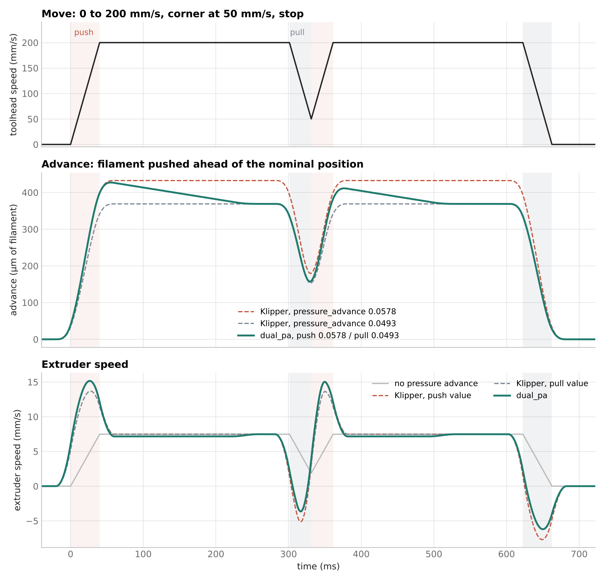
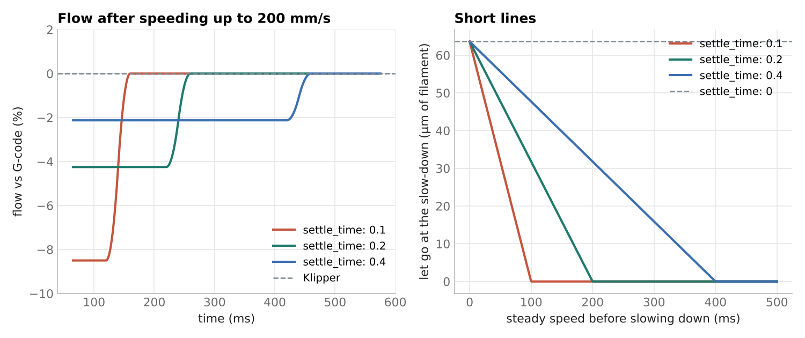

# Dual pressure advance

This document describes `[dual_pa]`, a Klipper module that uses one
pressure advance value while the extruder speeds up and another while it
slows down. It works with Klipper and Kalico.

Read Klipper's [Pressure advance](https://www.klipper3d.org/Pressure_Advance.html)
document first. `[dual_pa]` does not change how pressure advance is tuned,
only how the result is applied.

## Why

A pressure advance test shows two edges: one where the line starts
(speeding up) and one where it ends (slowing down). They often give
different values. Klipper uses one value for both, so one of the two ends
of every line is a compromise.

`[dual_pa]` takes both:

- `push_pressure_advance` is used while the extruder speeds up.
- `pull_pressure_advance` is used while it slows down.

With equal values it is Klipper's pressure advance, step for step.

## How it works

Klipper's pressure advance keeps the extruder ahead of its nominal
position by `pressure_advance * extruder_velocity`. This "advance" is the
filament that builds the pressure in the nozzle. It grows while the
extruder speeds up and goes back to zero when it stops.

The advance put in has to come out again, or every line would leave
filament behind. With two values this does not happen by itself:
speeding up to 200 mm/s with push 0.0578 stores more filament than
slowing down with pull 0.0493 gives back. So the advance is handled in
three parts:

1. Speeding up: the advance grows with `push_pressure_advance`. This is
   exactly what Klipper does with that value.
2. Steady speed: the advance moves from the push amount to the pull
   amount over `settle_time`.
3. Slowing down: the advance falls with `pull_pressure_advance`, exactly
   like Klipper with that value, and reaches zero when the extruder stops.



The graph shows a line at 200 mm/s with a corner at 50 mm/s. The red
dashed line is Klipper with the push value, the grey one Klipper with the
pull value. `dual_pa` follows the red line while speeding up (red bands)
and the grey line while slowing down (grey bands). In between it moves
from one to the other.

The same `pressure_advance_smooth_time` smoothing as Klipper is applied
on top.

### Settle time

Moving the advance from the push amount to the pull amount changes the
flow a little for `settle_time`. With the values above at 200 mm/s and the
default 0.2 s, the flow is 4.2% low for 0.2 s (40 mm of line). A shorter
settle time changes the flow more for less time.

If the line is shorter than `settle_time`, the advance has not reached
the pull amount when the slow down starts. The rest is let go at the start
of the slow down. With `settle_time: 0` all of it is let go there.



If `push_pressure_advance` is lower than `pull_pressure_advance` the same
happens the other way round: the flow is a little high while settling.

## Installation

```
cd ~
git clone https://github.com/VcikeyTheCoder/dual_pa.git
bash ~/dual_pa/install.sh
```

The script links `dual_pa.py` into `klippy/extras` (Klipper) or
`klippy/plugins` (Kalico), builds `libdual_pa.so` from `dual_pa.c` and
restarts Klipper. Klipper rebuilds the library by itself when `dual_pa.c`
or Klipper's C headers change. `gcc` is needed, as for Klipper itself.

To get updates in Moonraker, add to `moonraker.conf`:

```
[update_manager dual_pa]
type: git_repo
path: ~/dual_pa
origin: https://github.com/VcikeyTheCoder/dual_pa.git
primary_branch: main
managed_services: klipper
```

To remove it: `bash ~/dual_pa/install.sh --uninstall` and delete the
`[dual_pa]` section.

## Configuration

```
[dual_pa]
#extruder: extruder
#   Set by the section name: [dual_pa] is for 'extruder',
#   [dual_pa extruder1] for 'extruder1'.
#push_pressure_advance:
#   Pressure advance while the extruder speeds up. The default is the
#   extruder's pressure_advance.
#pull_pressure_advance:
#   Pressure advance while the extruder slows down. The default is the
#   extruder's pressure_advance.
#settle_time: 0.2
#   Time (in seconds) to move the advance from the push amount to the pull
#   amount while the speed is steady. 0 moves it at the start of the
#   slow down. The maximum is 2.
#smooth_time:
#   Same as pressure_advance_smooth_time. The default is the extruder's
#   pressure_advance_smooth_time.
```

Every stepper moving with the extruder uses these values, including
`[extruder_stepper]` sections synced to it.

## G-code commands

### SET_DUAL_PA

`SET_DUAL_PA [EXTRUDER=<name>] [PUSH=<value>] [PULL=<value>]
[SETTLE_TIME=<seconds>] [SMOOTH_TIME=<seconds>]`: Set the values. Without
parameters it reports the current ones. Like `SET_PRESSURE_ADVANCE`, the
change applies from the next move in the queue.

### SET_PRESSURE_ADVANCE

`SET_PRESSURE_ADVANCE ADVANCE=<value>` still works and sets push and pull
to the same value. Slicers that send it in the filament start G-code will
replace the `[dual_pa]` values, so put `SET_DUAL_PA` after it if needed.

The extruder status (as shown by Mainsail or Fluidd) reports the pull
value as `pressure_advance`.

## Status

`printer["dual_pa"]` (or `printer["dual_pa extruder1"]`) has
`push_pressure_advance`, `pull_pressure_advance`, `settle_time`,
`smooth_time` and `steppers` (the number of steppers using it).

## Tuning

1. Tune pressure advance as usual, but note both edges: where the start
   of the line looks right (push) and where the end looks right (pull).
   The PIRO-EDGE calibrator reports them as the rise edge and the fall
   edge.
2. Set `push_pressure_advance` and `pull_pressure_advance`.
3. Print a test with sharp corners and short lines and compare it with a
   single value.

Check that the difference is real before using it: test the same filament
a few times. If the two edges swap order between tests, use one value.

## Limits

- Retracts, unretracts and extrude only moves get no pressure advance,
  as in Klipper.
- Only the main extruder stepper is replaced at startup. Steppers synced
  later with `SYNC_EXTRUDER_MOTION` are switched over (and back) when the
  command runs.
- The extruder trapq stores the advance in fields Klipper does not use
  for the extruder. Other modules that read the extruder trapq directly
  see these values in its Y and Z columns.

## Tests

`tests/test_dual_pa.py` runs `dual_pa.c` next to Klipper's own
`kin_extruder.c`, `trapq.c` and `itersolve.c`:

```
KLIPPER_DIR=~/klipper python3 tests/test_dual_pa.py
```

It checks that equal values give Klipper's result, that speeding up and
slowing down match Klipper at the push and pull values, the settle flow,
that no filament is gained or lost, and that Klipper's step solver
produces valid steps. `scripts/make_graphs.py` draws the graphs in this
document from the same code.
